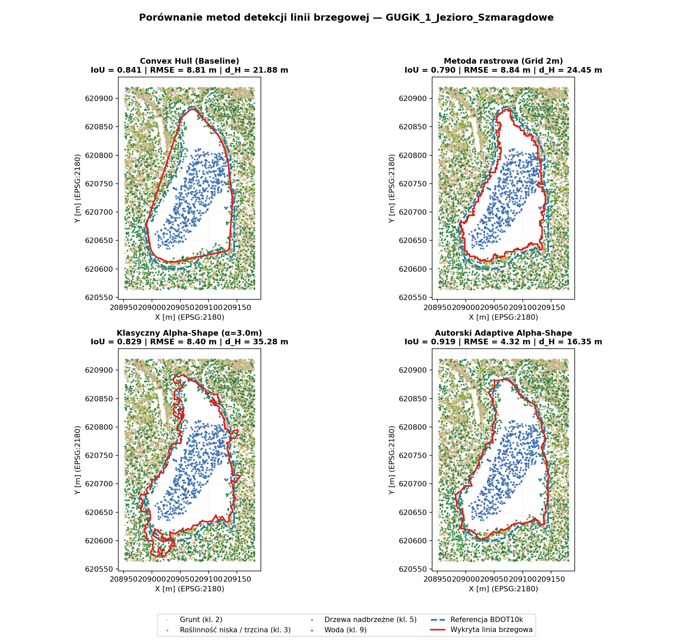
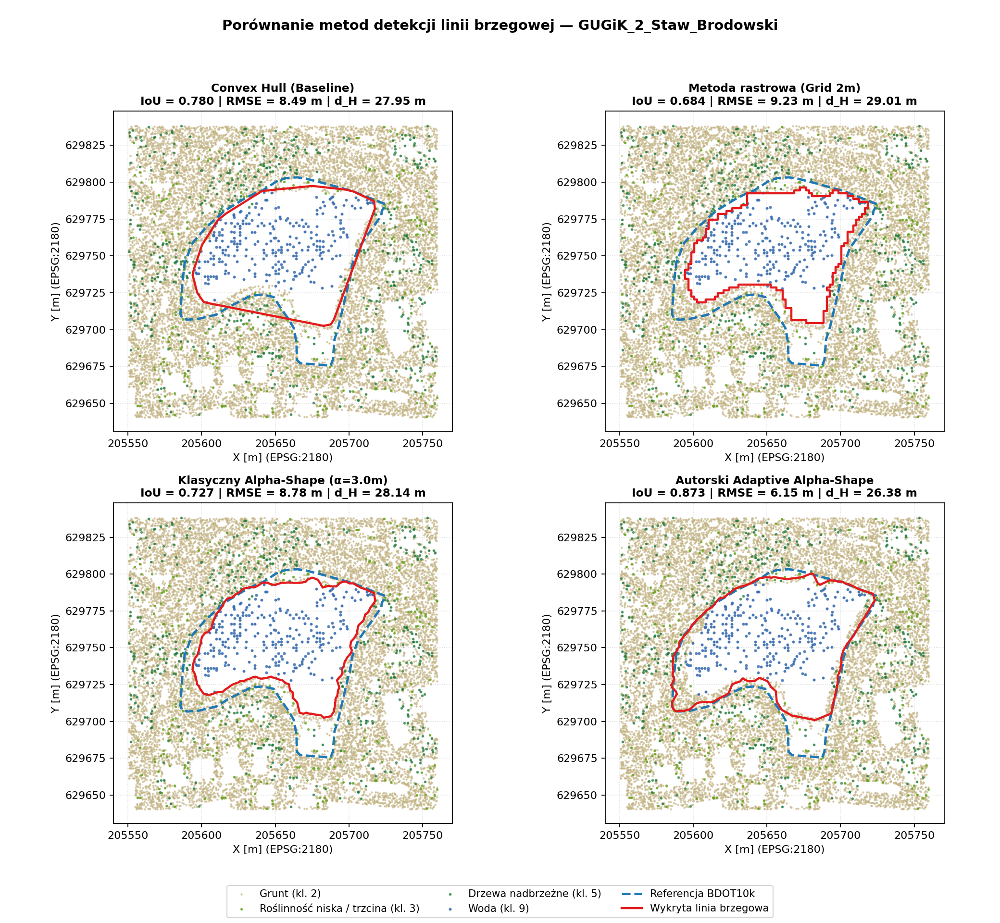
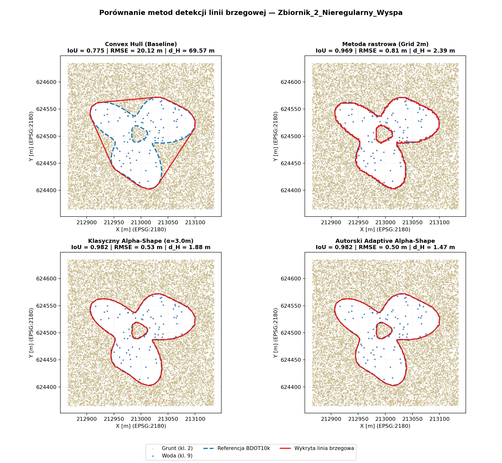
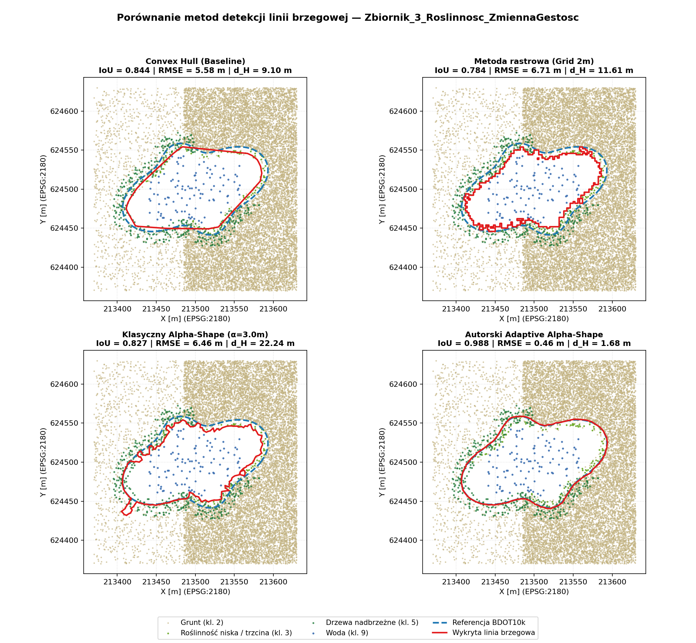
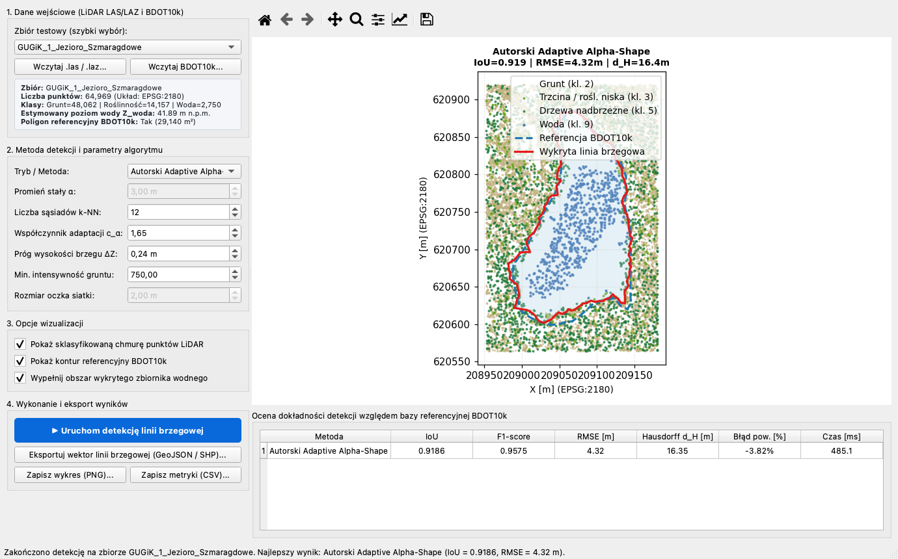
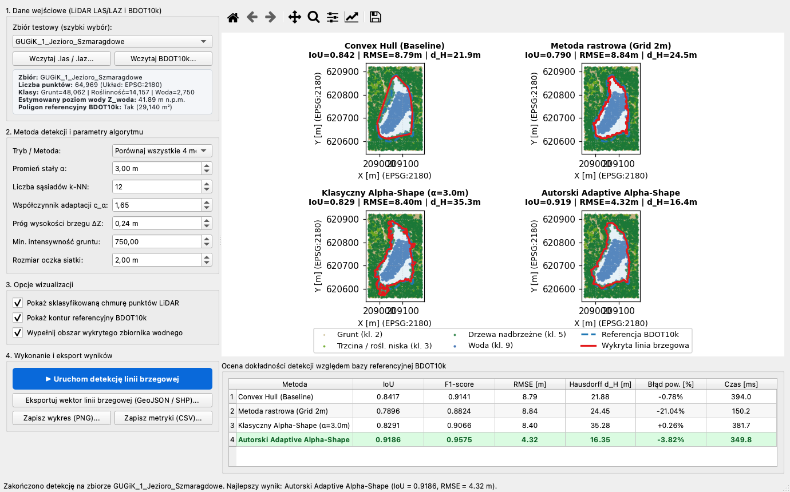

# Detekcja linii brzegowej zbiorników wodnych z chmur punktów LiDAR

Repozytorium kodu do pracy dyplomowej inżynierskiej (Wydział Informatyki, Zachodniopomorski Uniwersytet Technologiczny w Szczecinie):

> **PORÓWNANIE METOD DETEKCJI LINII BRZEGOWEJ ZBIORNIKÓW WODNYCH Z WYKORZYSTANIEM CHMUR PUNKTÓW SKANINGU LASEROWEGO (LIDAR)**  
> *Comparison of methods for detecting the shoreline of water bodies using laser scanning point clouds (LiDAR)*  
> **Autor:** Denys Tarakhkalo (nr albumu: 53867)  
> **Opiekun:** dr inż. Andrzej Łysko

---

## Cel projektu

Celem pracy jest analiza porównawcza metod wyznaczania linii brzegowej zbiorników wodnych na podstawie chmur punktów lotniczego skaningu laserowego (ALS / LiDAR w standardzie ISOK, układ `EPSG:2180`) w kontekście aktualizacji Bazy Danych Obiektów Topograficznych (**BDOT10k**, klasa `OT_PTWP_A`) oraz opracowanie **autorskiej modyfikacji algorytmu $\alpha$-shape** odpornej na roślinność przybrzeżną (trzcinowiska, nawisy koron drzew) i zmienną gęstość punktów gruntu.

## Porównywane metody

1. **Otoczka wypukła (`Convex Hull` — Baseline)** — szybka metoda bazowa wyznaczająca minimalny wielokąt wypukły.
2. **Metoda rastrowa (`Grid DSM / 2 m`)** — rzutowanie chmury punktów na regularną siatkę 2D z domknięciem morfologicznym i wektoryzacją pustek wodnych.
3. **Klasyczny algorytm `Alpha-Shape` ($\alpha = \text{const}$)** — triangulacja Delaunaya z globalnym progiem promienia okręgu opisanego $R(T) > \alpha$.
4. **Autorski `Adaptive Alpha-Shape` (proponowany)** — trójstopniowy algorytm:
   - **Filtracja hydro-LiDAR:** automatyczna estymacja rzędnej zwierciadła wody $Z_{\text{woda}}$, odrzucenie nawisów drzew (klasa 5) oraz szuwarów/trzcinowisk (klasa 3 oraz nisko położone odbicia o niskiej intensywności $\Delta Z < 0.24\text{ m}$).
   - **Lokalnie adaptacyjny dobór $\alpha_{\text{local}}(T)$:** wyznaczenie lokalnego odstępu między punktami gruntu $d_k(v)$ za pomocą drzewa `cKDTree` ($k=12$) i uzależnienie progu promienia okręgu opisanego od lokalnej gęstości punktów, co zapobiega „wyciekaniu" linii brzegowej na zalesionych brzegach o niskiej penetracji impulsu laserowego.
   - **Regularyzacja topologiczna i morfologiczna:** zachowanie wysp wewnętrznych powyżej progu powierzchniowego oraz wygładzenie artefaktów trójkątnych.

---

## Wyniki eksperymentów

| Zbiór danych | Metoda | IoU | F1 | RMSE [m] | Odległość Hausdorffa $d_H$ [m] | Błąd powierzchni [%] | Czas [ms] |
| :--- | :--- | :---: | :---: | :---: | :---: | :---: | :---: |
| `Zbiornik_1_Regularny` | **Convex Hull (Baseline)** | 0.9788 | 0.9893 | 0.83 | 2.52 | +1.28% | 173.1 |
| `Zbiornik_1_Regularny` | **Metoda rastrowa (Grid 2m)** | 0.9783 | 0.9890 | 0.82 | 2.47 | +1.10% | 89.7 |
| `Zbiornik_1_Regularny` | **Klasyczny Alpha-Shape ($\alpha=3.0\text{m}$)** | **0.9875** | **0.9937** | **0.49** | 1.71 | +0.76% | 167.8 |
| `Zbiornik_1_Regularny` | **Autorski Adaptive Alpha-Shape** | 0.9858 | 0.9929 | 0.54 | **1.67** | +0.26% | 248.9 |
| `Zbiornik_2_Nieregularny_Wyspa` | **Convex Hull (Baseline)** | 0.7749 | 0.8732 | 20.12 | 69.57 | +28.59% | 265.2 |
| `Zbiornik_2_Nieregularny_Wyspa` | **Metoda rastrowa (Grid 2m)** | 0.9689 | 0.9842 | 0.81 | 2.39 | +1.67% | 111.6 |
| `Zbiornik_2_Nieregularny_Wyspa` | **Klasyczny Alpha-Shape ($\alpha=3.0\text{m}$)** | 0.9816 | 0.9907 | 0.53 | 1.88 | +1.07% | 264.7 |
| `Zbiornik_2_Nieregularny_Wyspa` | **Autorski Adaptive Alpha-Shape** | **0.9821** | **0.9910** | **0.50** | **1.47** | **+0.28%** | 387.6 |
| `Zbiornik_3_Roslinnosc_ZmiennaGestosc` | **Convex Hull (Baseline)** | 0.8441 | 0.9155 | 5.58 | 9.10 | -11.09% | 154.7 |
| `Zbiornik_3_Roslinnosc_ZmiennaGestosc` | **Metoda rastrowa (Grid 2m)** | 0.7835 | 0.8786 | 6.71 | 11.61 | -20.89% | 80.8 |
| `Zbiornik_3_Roslinnosc_ZmiennaGestosc` | **Klasyczny Alpha-Shape ($\alpha=3.0\text{m}$)** | 0.8269 | 0.9052 | 6.46 | 22.24 | -10.87% | 140.8 |
| `Zbiornik_3_Roslinnosc_ZmiennaGestosc` | **Autorski Adaptive Alpha-Shape** | **0.9880** | **0.9940** | **0.46** | **1.68** | **+0.12%** | 149.4 |
| `GUGiK_1_Jezioro_Szmaragdowe` *(Szczecin)* | **Convex Hull (Baseline)** | 0.8407 | 0.9135 | 8.81 | 21.88 | -0.91% | 281.9 |
| `GUGiK_1_Jezioro_Szmaragdowe` *(Szczecin)* | **Metoda rastrowa (Grid 2m)** | 0.7896 | 0.8824 | 8.84 | 24.45 | -21.04% | 95.8 |
| `GUGiK_1_Jezioro_Szmaragdowe` *(Szczecin)* | **Klasyczny Alpha-Shape ($\alpha=3.0\text{m}$)** | 0.8291 | 0.9066 | 8.40 | 35.28 | +0.26% | 251.5 |
| `GUGiK_1_Jezioro_Szmaragdowe` *(Szczecin)* | **Autorski Adaptive Alpha-Shape** | **0.9186** | **0.9576** | **4.32** | **16.35** | -3.82% | 278.9 |
| `GUGiK_2_Staw_Brodowski` *(Szczecin)* | **Convex Hull (Baseline)** | 0.7804 | 0.8767 | 8.49 | 27.95 | -15.59% | 290.8 |
| `GUGiK_2_Staw_Brodowski` *(Szczecin)* | **Metoda rastrowa (Grid 2m)** | 0.6843 | 0.8126 | 9.23 | 29.01 | -31.57% | 31.0 |
| `GUGiK_2_Staw_Brodowski` *(Szczecin)* | **Klasyczny Alpha-Shape ($\alpha=3.0\text{m}$)** | 0.7267 | 0.8417 | 8.78 | 28.14 | -27.03% | 300.8 |
| `GUGiK_2_Staw_Brodowski` *(Szczecin)* | **Autorski Adaptive Alpha-Shape** | **0.8734** | **0.9324** | **6.15** | **26.38** | **-11.40%** | 366.2 |

### Wizualizacja porównawcza

#### 1. Dane rzeczywiste GUGiK (Szczecin): Jezioro Szmaragdowe (`GUGiK_1_Jezioro_Szmaragdowe`)


#### 2. Dane rzeczywiste GUGiK (Szczecin): Staw Brodowski (`GUGiK_2_Staw_Brodowski`)


#### 3. Zbiornik o złożonej linii brzegowej z wyspą (`Zbiornik_2_Nieregularny_Wyspa`)


#### 4. Zbiornik z roślinnością przybrzeżną i zmienną gęstością punktów (`Zbiornik_3_Roslinnosc_ZmiennaGestosc`)


---

## Graficzny interfejs użytkownika (GUI — Rozdział 4.3 i 5.3)

Aplikacja okienkowa zbudowana w oparciu o **PyQt6** oraz interaktywne płótno **Matplotlib (`FigureCanvasQTAgg`)** umożliwia:
- wczytywanie chmur punktów `.las`/`.laz` oraz warstw referencyjnych `BDOT10k` (`.geojson`, `.shp`, `.gpkg`),
- interaktywne sterowanie parametrami filtracji hydro-LiDAR ($\Delta Z$, próg intensywności) oraz adaptacyjnego doboru promienia $\alpha_{\text{local}}(T)$ ($k$-NN, $c_\alpha$),
- pracę w trybie pojedynczego algorytmu lub w trybie porównawczym **2x2 (wszystkie 4 metody jednocześnie)** wraz z tabelą metryk (**IoU**, **F1**, **RMSE**, **Hausdorff $d_H$**),
- bezpośredni eksport wyznaczonej linii brzegowej do formatów GIS (`GeoJSON`, `Shapefile`, `GeoPackage`) na potrzeby aktualizacji bazy **BDOT10k**.





---

## Struktura projektu

- `src/domain/models.py` — modele danych dla chmur punktów ASPRS LAS 1.4 (`EPSG:2180`), wyników detekcji oraz metryk.
- `src/io/lidar_io.py` — wczytywanie i zapis plików `.las`/`.laz` (`laspy`), estymacja rzędnej zwierciadła wody $Z_{\text{woda}}$, obsługa wektorów referencyjnych BDOT10k (`geopandas`).
- `src/data/synth_generator.py` — generator trzech reprezentatywnych zbiorów testowych `.las` wraz z poligonami referencyjnymi BDOT10k (`OT_PTWP_A`).
- `src/data/gugik_helper.py` — narzędzie do przycinania rzeczywistych arkuszy `.laz` z Geoportalu (GUGiK ISOK) oraz warstwy `OT_PTWP_A` z bazy BDOT10k dla zbiorników w okolicach Szczecina (*Jezioro Szmaragdowe*, *Jezioro Głębokie*, *Staw Brodowski*).
- `src/methods/` — implementacje badanych algorytmów detekcji linii brzegowej.
- `src/evaluation/` — obliczanie metryk jakości (**IoU**, **F1**, **odległość Hausdorffa $d_H$**, **RMSE linii brzegowej**, **błąd powierzchni**) oraz generowanie wykresów porównawczych.

## Uruchomienie

```bash
python3 -m venv .venv
.venv/bin/pip install -r requirements.txt

# 1. Uruchomienie potoku badawczego (CLI / benchmark):
.venv/bin/python run_benchmark.py

# 2. Uruchomienie aplikacji graficznej (GUI PyQt6):
.venv/bin/python run_gui.py
```
